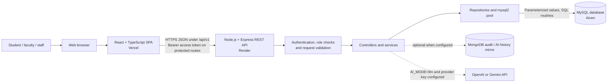
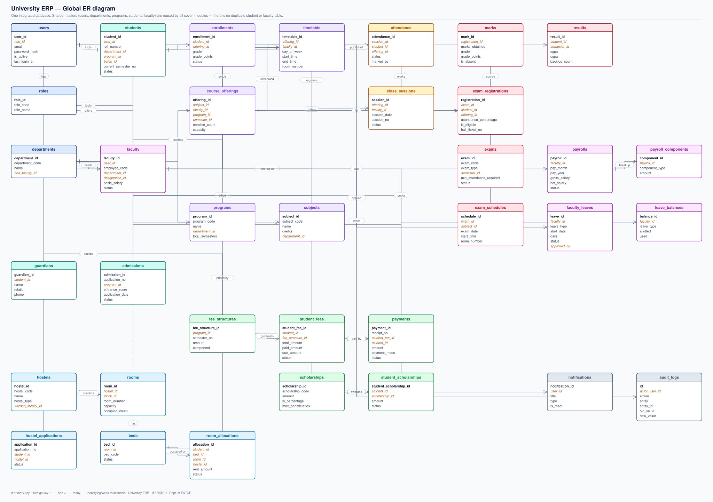
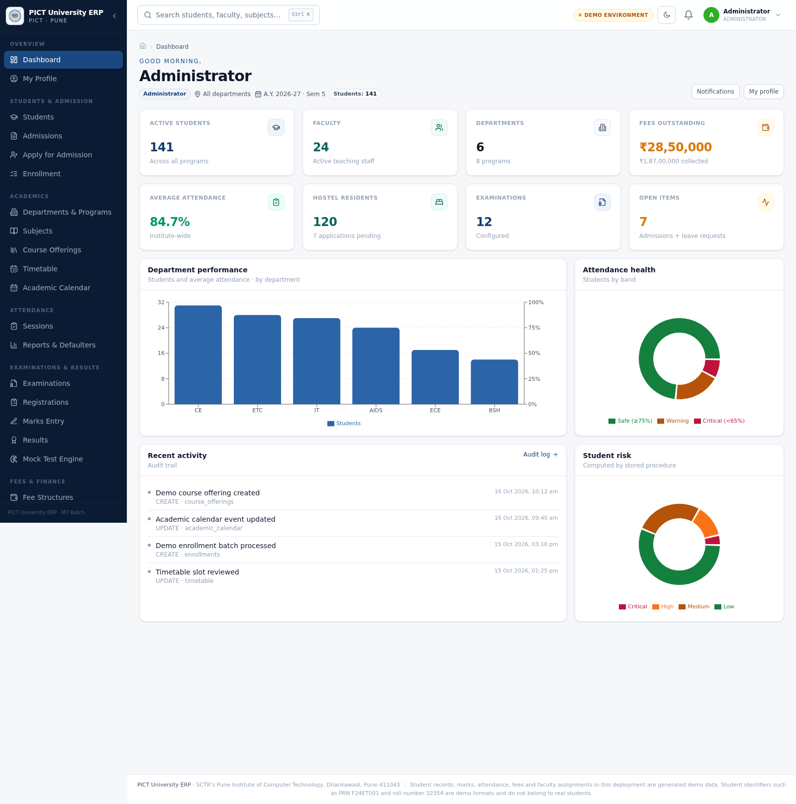
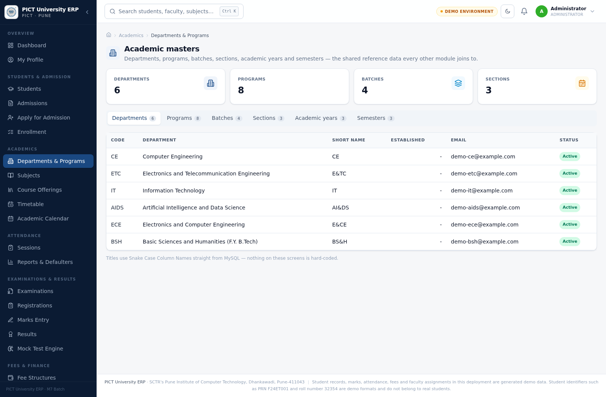
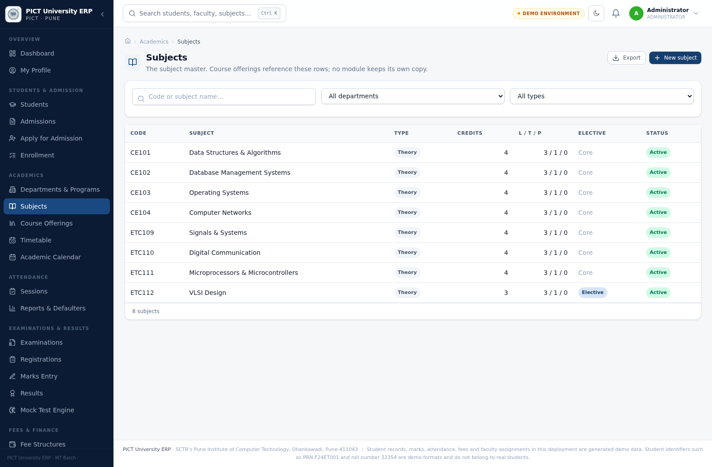
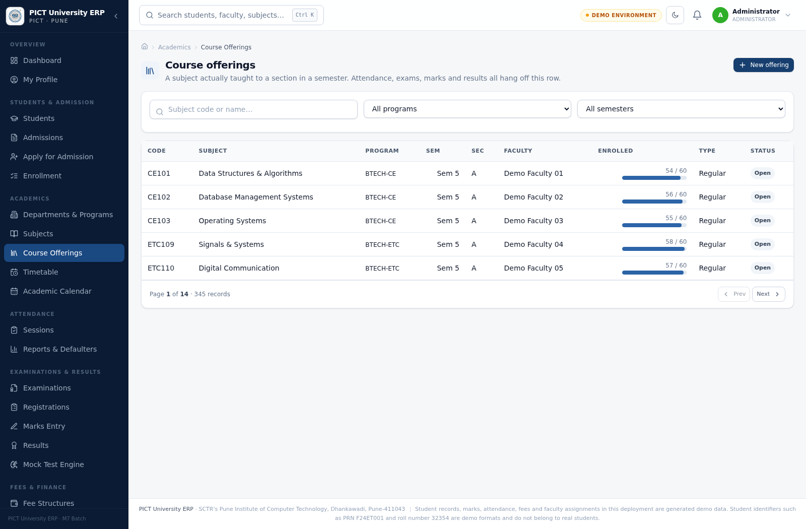
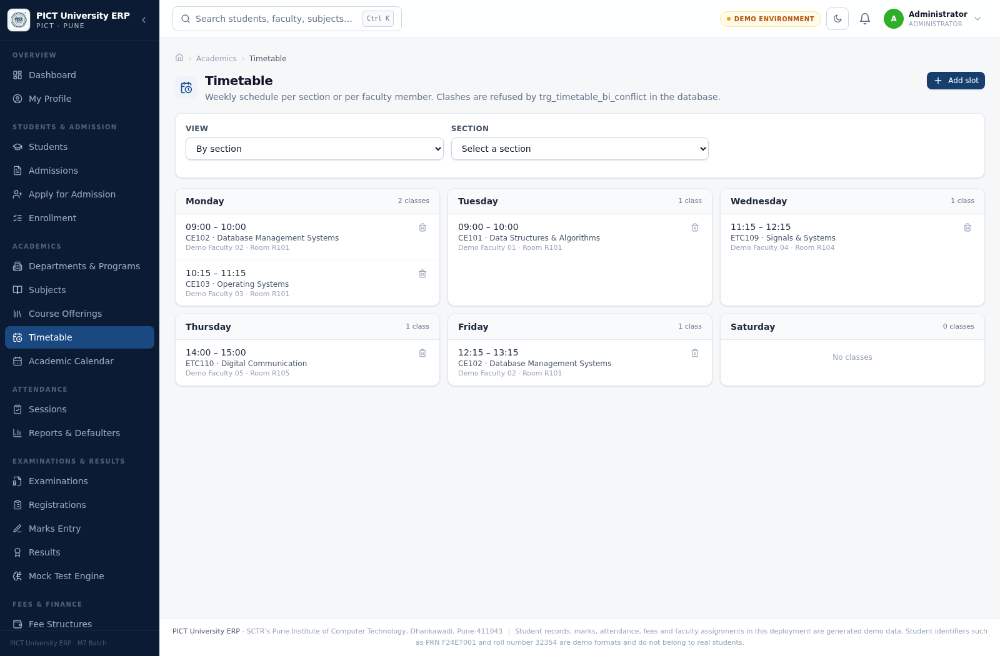
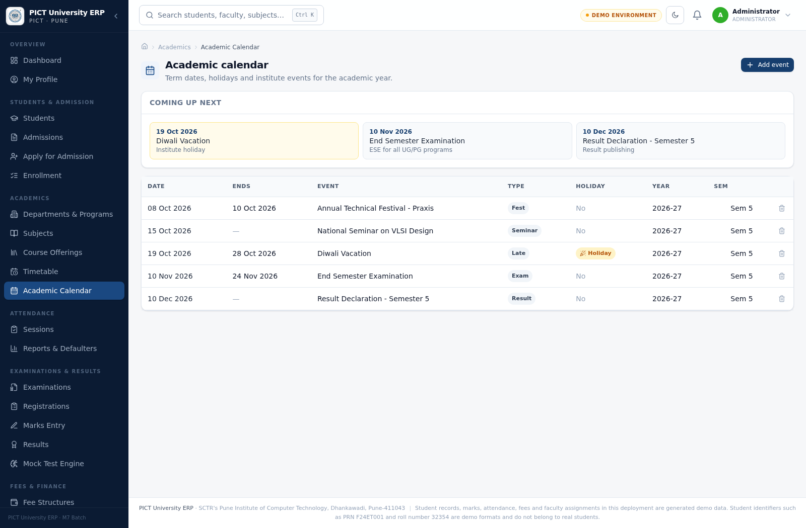

# University Higher Education ERP System


**Institution:** Pune Institute of Computer Technology (PICT), Pune  
**Project type:** DBMS college major project  
**Repository:** [harshtakalkar037-boop/DBMS-PROJECT](https://github.com/harshtakalkar037-boop/DBMS-PROJECT)

A university manages connected processes—admissions, courses, attendance, examinations, fees, accommodation and staff—yet those processes are often split across separate records and tools. That separation creates duplicate data, inconsistent updates and manual reconciliation. This project brings those workflows into one web application backed by a shared relational database and seven role-based ERP modules.

> **Scope and data notice:** This is an academic prototype, not a certified or production-ready system for real institutional records. The repository describes its SQL seed as generated demonstration data; some fields are deliberately person-shaped. Review and replace seed data before any public demonstration, and never load it into a live institutional database. This README does not publish demo passwords.

## Table of Contents

- [Live Application](#live-application)
- [Key Features](#key-features)
- [Seven ERP Modules](#seven-erp-modules)
- [User Roles and Permissions](#user-roles-and-permissions)
- [Student Admission Workflow](#student-admission-workflow)
- [Technology Stack](#technology-stack)
- [System Architecture](#system-architecture)
- [Database Design and DBMS Concepts](#database-design-and-dbms-concepts)
- [Repository Structure](#repository-structure)
- [Local Installation and Setup](#local-installation-and-setup)
- [Environment Variables](#environment-variables)
- [Demo Accounts and Login Instructions](#demo-accounts-and-login-instructions)
- [API Documentation](#api-documentation)
- [Testing and Validation](#testing-and-validation)
- [Deployment Guide](#deployment-guide)
- [Security and Privacy](#security-and-privacy)
- [Screenshots](#screenshots)
- [Known Limitations and Troubleshooting](#known-limitations-and-troubleshooting)
- [Learning Outcomes and DBMS Viva Highlights](#learning-outcomes-and-dbms-viva-highlights)
- [Contributors and Acknowledgements](#contributors-and-acknowledgements)
- [Project Documentation](#project-documentation)

## Live Application

| Surface | Link / value |
|---|---|
| Frontend | [https://dbms-project-snowy-three.vercel.app](https://dbms-project-snowy-three.vercel.app/) |
| Backend base URL | [https://dbms-project-x7d7.onrender.com](https://dbms-project-x7d7.onrender.com/) |
| API prefix | `/api/v1` |
| Health route | `/api/v1/health` |

These deployment URLs were supplied for the project. Repository inspection and local validation do not verify the current state of Vercel, Render or Aiven. If the Render service is on a free or scale-to-zero plan, it may sleep after inactivity and take longer to answer the first request after waking.

A live URL is not a public demo login and does not imply suitability for real student, faculty or financial data. The deployed environment-variable values are not present in the repository and are not asserted here.

## Key Features

The repository contains frontend pages, backend API handlers and database objects for the following workflows. Whether a workflow is usable in a hosted environment depends on that environment's database, account and feature configuration.

### Implemented in the codebase

- Public student application form, admission review and approval by an administrator.
- Student, academic, attendance, examination, finance, hostel and faculty/HR/payroll workflows using shared student, faculty, course and role records.
- Role-specific dashboards, a shared application shell, profile and password-change screens, navigation guards and an API-backed global search.
- Individual and bulk attendance recording, attendance summaries and low-attendance reporting.
- Examination setup, schedules, registration, marks, result processing/publication and hall-ticket views.
- Fee structures, bills, recorded payments and receipts, late fees, scholarships, fines, refunds and finance exports. This is a ledger/workflow feature, not an integrated payment gateway.
- Hostel applications, rooms/beds, allocation, transfer, vacation and occupancy reporting.
- Faculty records, teaching assignments, leave requests/balances and payroll generation/status workflows.
- Notifications, audit records, role-oriented reports and CSV export.
- Mock examination attempts, answer submission, review and leaderboard routes.
- Student study-plan and risk-analysis screens. The default AI engine is a local rule-based implementation; optional OpenAI and Google Gemini modes are enabled only when explicitly configured.

### Optional integrations and scope boundaries

- MongoDB is optional. When `MONGODB_URI` is configured, the backend can mirror audit events and AI conversation history; MySQL remains the relational system of record.
- OpenAI and Google Gemini are optional. When enabled, selected student context is sent to the selected provider; review its data-use terms and privacy implications before enabling this for any non-synthetic data.
- No SMTP/email delivery or third-party payment-provider integration was found in the current source. Admission credentials are shown to the administrator in the application rather than emailed automatically.
- Some business-rule claims in older narrative documents are not implemented as described. See [Known Limitations](#known-limitations-and-troubleshooting) before presenting those claims as working behavior.

## Seven ERP Modules

| # | Module | Verified scope in the source |
|---:|---|---|
| 1 | **Student and Admission Management** | Public application submission; administrator review; student records, status, addresses, guardians and document metadata. Approval creates a linked student and login account. |
| 2 | **Academic and Course Management** | Shared academic masters, programs, batches, sections, subjects, offerings, faculty-subject assignments, enrolments, timetable and academic calendar. The database includes capacity and timetable conflict checks. |
| 3 | **Attendance Management** | Class sessions, rosters, individual and bulk marking, student summaries, attendance reports and low-attendance notifications. Attendance is checked by the exam-registration workflow. |
| 4 | **Examination and Results** | Exams and schedules, registration and eligibility, marks, result processing/publication, rankings and student hall-ticket/result views. |
| 5 | **Fees and Payments** | Fee structures, student bills, payment records/receipts, late fees, scholarships, fines, refunds, defaulter reporting and CSV export. Payments are recorded in the application; no external processor is configured. |
| 6 | **Hostel Management** | Hostels, blocks, rooms and beds; applications and review; allocation, transfer, vacation and occupancy. Database triggers maintain selected capacity/occupancy values. |
| 7 | **Faculty, HR and Payroll** | Faculty records and teaching load, leave requests and balances, HR review, payroll generation, payslip status and payroll summaries. |

The modules share master records rather than maintaining separate copies of students, faculty, departments or subjects. Examples of cross-module flows include admission approval creating a student account, enrolment feeding attendance, attendance feeding exam eligibility, and hostel allocation updating occupancy.

## User Roles and Permissions

The backend defines seven role codes. The table summarizes typical capabilities; actual access is route-specific and enforced by backend middleware and service logic.

| Role | Typical supported access |
|---|---|
| **Administrator** (`ADMIN`) | Broad management access across modules, admission review, academic setup, system settings and audit/report views. |
| **Student** (`STUDENT`) | Student-facing views such as own attendance, results, fees, hostel and mock-exam records. Student-specific API paths substitute or check the authenticated student's linked ID where implemented. |
| **Faculty** (`FACULTY`) | Teaching load, attendance sessions/marking, eligible academic and marks workflows, reports and faculty leave functions. |
| **Examination Cell** (`EXAM_CELL`) | Exam administration, schedules, registrations, eligibility, results and related reporting. |
| **Accountant** (`ACCOUNTANT`) | Fee structures, bills, payment records, scholarships, fines, refunds and finance reports/exports. |
| **Hostel Administrator** (`HOSTEL_ADMIN`) | Hostel facilities, applications, rooms/beds, allocations, transfers, vacation and occupancy. |
| **HR** (`HR`) | Faculty records, leave review, payroll generation/status and HR reporting. |

Authentication uses JWTs. Protected backend routes run `authenticate`; role-restricted routes additionally use `requireRole`, and selected student records use self-or-role checks. The frontend's `RoleGate` renders an access-restricted page for disallowed routes, but the backend—not hidden navigation—is the security boundary.

## Student Admission Workflow

1. A visitor opens the public form at `/admissions/apply`. The application-options endpoint provides active programs for the current academic year and available categories. No account or role selection is required to submit.
2. The backend validates the submitted application and inserts it with the initial `APPLIED` status. Duplicate email submissions are rejected by application checks and database uniqueness rules.
3. An administrator reviews applications in the admissions workspace. Review is handled by `POST /api/v1/students/admissions/:id/review` and can approve or reject an application.
4. On approval, `sp_approve_admission` runs a database transaction. It creates the `users` login row and linked `students` row, assigns the student role, generates roll/registration numbers, links guardian information, updates the application and records an in-app notification/audit event. The current procedure does not generate a first fee bill as part of admission approval.
5. The API returns a randomly generated temporary password to the administrator, and the admissions UI displays it once. The application does not email credentials. The administrator must deliver the temporary password to the applicant through an appropriate verified channel.
6. The newly approved student signs in using the application email and temporary password. The frontend routes accounts marked as first-login to `/change-password`; the browser flow asks the student to set a new password before returning to the dashboard.

The first-login redirect is currently a frontend behavior; see the security notes below for the backend-enforcement limitation.

## Technology Stack

| Layer | Technologies verified in the repository |
|---|---|
| Frontend | React 18, TypeScript, Vite, Tailwind CSS, React Router, Axios, Framer Motion, Recharts, Lucide React, `date-fns` and `clsx`. `@tanstack/react-query` is listed as a dependency, but no current application import was found. |
| Backend | Node.js (package engine `>=18`; Dockerfiles use Node 20), Express 4, TypeScript, `mysql2/promise`, `bcryptjs`, `jsonwebtoken`, Zod, Helmet, CORS, `express-rate-limit`, Morgan and `cookie-parser`. Vitest is used for backend unit tests. |
| Primary database | MySQL 8-compatible SQL using InnoDB, foreign keys, constraints, indexes, stored procedures, functions, triggers and views. The local Compose database is MariaDB 11.8; hosted deployment is specified as Aiven MySQL. |
| Optional services | MongoDB for audit/AI-history mirroring; OpenAI or Google Gemini API for the opt-in LLM mode. Neither is required for the MySQL-backed ERP core. |
| Hosting targets | Vercel (frontend), Render (backend) and Aiven (MySQL), as supplied in the project brief. |

## System Architecture



In local development, the browser still uses the `/api/v1` API path. The Vite development server proxies `/api` to `VITE_API_TARGET` (default `http://127.0.0.1:8080`). That Vite proxy is not a production Vercel proxy; deployment configuration is described in the [deployment guide](#deployment-guide).

The repository includes schema-derived global and module ER diagrams. The global diagram is shown below; see [`docs/ER_DIAGRAMS.md`](docs/ER_DIAGRAMS.md) for the module diagrams and Mermaid sources.



## Database Design and DBMS Concepts

The SQL files and generated data dictionary describe the following schema objects:

| Object | Count |
|---|---:|
| Base tables | 61 |
| Documented columns | 677 |
| Foreign-key constraints | 138 |
| Views | 20 |
| Stored procedures | 17 |
| User-defined functions | 13 |
| Triggers | 28 |

### Relational design and integrity

- Primary keys identify rows; foreign keys connect shared entities and enforce referential integrity across modules. Unique constraints protect business identifiers such as account email, roll number and receipt number. `NOT NULL`, defaults and `CHECK` constraints represent required values and domain rules.
- The model separates shared entities—such as `users`, `roles`, `students`, `faculty`, departments, programs and subjects—from associative/transactional relations such as `enrollments`, `attendance`, `exam_registrations` and `room_allocations. The project report describes the design as 3NF; the schema also contains intentional denormalized counters/roll-ups for operational reads.
- Secondary and unique indexes support common joins, filters and lookup keys. Money columns use decimal types rather than binary floating point.
- Selected multi-step workflows use stored procedures and transactions with rollback handling. Other service operations use the backend transaction helper where appropriate.

### Stored logic and reporting

- **Procedures** implement workflows such as admission approval, bulk enrolment, attendance marking, exam registration, fee payment, hostel allocation and payroll generation.
- **Functions** provide reusable calculations for attendance, grades, SGPA/CGPA, outstanding dues, late fees, hostel availability and related reporting.
- **Triggers** enforce selected cross-client rules, derive marks/grades, reject duplicate or over-capacity enrolments, detect timetable conflicts, protect selected hostel capacity values and record selected audit events.
- **Views** provide read models for dashboards and reports, including student profiles, attendance, fee status, exam eligibility, results, hostel occupancy and rankings.
- `database/09_queries.sql` contains 45 annotated analytical queries demonstrating joins, aggregation, subqueries, CTEs, recursive CTEs and window functions.

These database rules complement backend validation: request schemas can reject malformed input, while SQL constraints and selected procedures/triggers protect the corresponding records from invalid writes through other clients. The database does not currently enforce every business rule described in the companion narrative documents; see the [limitations](#known-limitations-and-troubleshooting).

## Repository Structure

```text
DBMS-PROJECT/
├── backend/
│   ├── src/
│   │   ├── config/          Environment, MySQL pool and optional MongoDB
│   │   ├── controllers/     HTTP request handlers
│   │   ├── middleware/      JWT authentication, RBAC, validation, errors
│   │   ├── repositories/    SQL data access
│   │   ├── routes/          Versioned REST route groups
│   │   ├── services/        Workflow and business logic
│   │   └── scripts/         DB checks, SQL runner and local utilities
│   └── tests/               Backend unit tests
├── frontend/
│   └── src/
│       ├── components/      Shared shell, auth, UI and dashboard components
│       ├── pages/           Module pages and role dashboards
│       ├── lib/             API client, auth, types and helpers
│       └── theme/           Design tokens and theme provider
├── database/
│   ├── 01_schema.sql … 09_queries.sql
│   └── migrations/          Dated SQL upgrade scripts
├── docs/
│   ├── DATA_DICTIONARY.md
│   ├── ER_DIAGRAMS.md
│   ├── MODULE_INTEGRATION.md
│   ├── er/                  Generated Mermaid and SVG ER diagrams
│   └── reports/group2/      Module report assets and UI screenshots
├── scripts/                 Seed, ER and data-dictionary generators
├── tests/
│   ├── api/                 Smoke and workflow scripts
│   └── db/                  SQL business-rule tests
├── docker-compose.yml       Local MariaDB + API + Vite development stack
└── README.md
```

## Local Installation and Setup

### Prerequisites

- Node.js 20 recommended (the backend package declares Node.js 18 or later) and npm.
- MySQL 8 or a compatible MariaDB release; the schema header targets MySQL 8 / MariaDB 10.6+.
- MySQL command-line client.
- Python 3 only if you run the data/diagram generators or Python API workflow script.
- Docker Compose is optional.

### Clone and install dependencies

```bash
git clone https://github.com/harshtakalkar037-boop/DBMS-PROJECT.git
cd DBMS-PROJECT

cd backend
npm ci
cd ../frontend
npm ci
cd ..
```

### Configure local environment files

If local files do not already exist, copy the templates and edit them privately:

```bash
cp backend/.env.example backend/.env
cp frontend/.env.example frontend/.env.local
```

Set the backend's MySQL connection to your local database, use fresh local-only JWT secrets, and keep the API prefix at `/api/v1`. For the frontend, `/api/v1` is the default API base; the Vite proxy target defaults to the local backend at `127.0.0.1:8080`. Do not overwrite an existing local environment file, commit secrets, or copy production secrets into a development machine.

### Create and initialize a disposable local database

The scripts are intended to initialize a fresh database. Create the expected database name first; the seed script selects `university_erp` internally.

```bash
mysql -u <database_admin> -p -e \
  "CREATE DATABASE university_erp CHARACTER SET utf8mb4 COLLATE utf8mb4_unicode_ci;"

cat \
  database/01_schema.sql \
  database/02_tables.sql \
  database/03_constraints.sql \
  database/07_functions.sql \
  database/08_views.sql \
  database/04_seed.sql \
  database/05_procedures.sql \
  database/06_triggers.sql \
  | mysql -u <database_admin> -p university_erp
```

The order follows the instructions in `database/01_schema.sql`: shared schema, tables, constraints, functions, views, generated seed, procedures and triggers. `database/09_queries.sql` is an analytical query set; it is not part of schema initialization. Use only a new, isolated local database. Do not run reset, seed or initialization scripts against Aiven, production or any shared database.

### Start the API and frontend

Use two terminals from the repository root:

```bash
# Terminal 1
cd backend
npm run dev
```

```bash
# Terminal 2
cd frontend
npm run dev
```

Open [http://localhost:5173](http://localhost:5173). The local API health route is `http://127.0.0.1:8080/api/v1/health`. The backend checks database connectivity during startup and exits if it cannot connect.

### Optional Docker Compose

`docker-compose.yml` starts a local MariaDB 11.8 database, backend and Vite development server:

```bash
docker compose up --build
```

The Compose file contains local fallback passwords/secrets for convenience. Override them with unique local-only values before use; do not expose these ports publicly or treat the Compose setup as a production deployment. The database volume is persistent. Avoid `docker compose down -v` unless you intentionally want to delete that local volume and its data.

## Environment Variables

The checked-in templates are [`backend/.env.example`](backend/.env.example) and [`frontend/.env.example`](frontend/.env.example). Backend names below come from `backend/src/config/env.ts`; Vite values are read at build or development-server startup. A `VITE_` variable is embedded in browser assets and must never contain a secret.

### Backend

| Variable | Purpose and source behavior |
|---|---|
| `NODE_ENV` | Runtime mode. The source defaults to development; set explicitly to `production` on Render. |
| `PORT` | HTTP listen port; defaults to `8080`. Render supplies a port at runtime. |
| `API_PREFIX` | API mount prefix; defaults to `/api/v1`. |
| `DB_HOST`, `DB_PORT` | MySQL host and port; local defaults are `127.0.0.1` and `3306`. |
| `DB_USER`, `DB_PASSWORD`, `DB_NAME` | MySQL account and database. Configure a private password; the default database name is `university_erp`. |
| `DB_CONNECTION_LIMIT` | MySQL pool size; defaults to `15`. |
| `DB_SOCKET_PATH` | Optional local Unix socket. When set, the pool uses it instead of `DB_HOST`/`DB_PORT`; this variable is supported in code but not listed in the example template. |
| `JWT_SECRET`, `JWT_REFRESH_SECRET` | Signing secrets. The source has development-only fallback values; replace both with different high-entropy secrets in every hosted environment. |
| `JWT_EXPIRES_IN`, `JWT_REFRESH_EXPIRES_IN` | Access-token and refresh-token lifetime; source defaults are `8h` and `7d`. |
| `BCRYPT_ROUNDS` | Password-hash work factor; defaults to `10`. |
| `ALLOW_SEEDED_DEMO_LOGINS` | Explicit gate for the seven designated seeded identities; defaults to `false`. See [Demo Accounts](#demo-accounts-and-login-instructions). |
| `CORS_ORIGIN` | Comma-separated origin configuration. The current CORS callback still allows unmatched origins, so this value is not an effective allowlist until that implementation is corrected. |
| `MONGODB_URI`, `MONGODB_DB` | Optional MongoDB audit/AI-history mirror. The database name defaults to `university_erp_events`; MongoDB is not required for the ERP core. |
| `AI_MODE`, `OPENAI_API_KEY`, `OPENAI_MODEL` | AI mode and optional OpenAI configuration. The local engine is the default; the key is a server-side secret. |
| `UPLOAD_DIR`, `MAX_UPLOAD_MB` | Declared configuration values (defaults `./uploads` and `5`). No active upload route was found in the current route inventory. |

### Frontend and Vite development server

| Variable | Purpose |
|---|---|
| `VITE_API_BASE` | Axios API base; defaults to `/api/v1`. For a separate hosted API, set the full HTTPS API base at build time or configure a same-origin rewrite. |
| `VITE_SHOW_DEMO_ACCOUNTS` | Production-build switch for the email-only demo picker. It does not authenticate users or enable server-side logins. |
| `VITE_API_TARGET` | Vite development proxy target; defaults to `http://127.0.0.1:8080`. It is read by the Vite config, not exposed as a browser secret. |

Never put database passwords, JWT secrets, OpenAI keys or private tokens in `VITE_*` variables. The root `.gitignore` excludes local `.env` files; keep that protection intact.

## Demo Accounts and Login Instructions

The seeded roles are **Administrator**, **Student**, **Faculty**, **Examination Cell**, **Accountant**, **Hostel Administrator** and **HR**. No demo password or account email is published in this README.

The two flags have different purposes:

- **Frontend picker — `VITE_SHOW_DEMO_ACCOUNTS`:** local development displays the picker automatically. A production build displays it only when the flag is exactly `true`. Picking a card fills an email and leaves the password blank; the normal login endpoint and password verification are still used.
- **Backend login gate — `ALLOW_SEEDED_DEMO_LOGINS`:** defaults to `false`. For the designated seeded identities, the normal login/refresh path is blocked in production unless this flag is explicitly enabled. Explicitly configured `NODE_ENV=development` is a local-development exception. Enabling the flag does not bypass password hashing/verification, account status, linked student/faculty checks, JWT issuance or role authorization.

**Current academic-demo configuration:** the Render backend has `ALLOW_SEEDED_DEMO_LOGINS=true` enabled for the current college demonstration, and the backend deployment was verified as live on 17 October 2026. This allows the designated seeded accounts to use the normal login flow; it does not bypass password verification or role authorization. The Vercel demo-account picker is a separate build-time setting and is not required when users sign in or create a student application manually. Keep `ALLOW_SEEDED_DEMO_LOGINS=false` in any environment that contains real institutional data. Previously shared seed passwords should be treated as exposed and rotated separately; never reuse demo credentials for real records.

## API Documentation

All route paths below include the default `/api/v1` prefix. The prefix is configurable through `API_PREFIX`. Protected calls use the access JWT in `Authorization: Bearer <token>`; `:id` and `:key` are path parameters.

### Route groups

| Prefix | Area |
|---|---|
| `/auth` | Login, refresh, logout, current user, password change and role list |
| `/students` | Student records and public/admin admission workflows |
| `/academics` | Academic masters, subjects, offerings, enrolments, timetable and calendar |
| `/attendance` | Sessions, marking, student views and reports |
| `/exams` | Exams, schedules, registration, marks, results and hall tickets |
| `/fees` | Fee structures, bills, payments, scholarships, fines, refunds and exports |
| `/hostel` | Facilities, applications, allocations, transfers and occupancy |
| `/faculty` | Faculty, workload, leaves and payroll |
| `/notifications`, `/mock-exams`, `/ai`, `/reports` | Cross-cutting user features and reporting |
| `/health`, `/dashboard`, `/search`, `/audit`, `/settings` | Health and shared system endpoints mounted at the API root |

### Selected endpoints

| Method | Endpoint | Authentication / role | Description |
|---|---|---|---|
| `GET` | `/api/v1/health` | Public | API/database health response. The current response also includes database metadata and row counts; see [Security and Privacy](#security-and-privacy). |
| `POST` | `/api/v1/auth/login` | Public | Validates credentials and returns JWT token data. |
| `POST` | `/api/v1/auth/refresh` | Valid refresh token required | Issues refreshed token data; the current SPA does not call this endpoint automatically. |
| `POST` | `/api/v1/auth/logout` | Authenticated | Clears the server-side refresh-token record. |
| `GET` | `/api/v1/auth/me` | Authenticated | Returns the current account profile. |
| `GET` | `/api/v1/students/admissions/options` | Public | Returns options for the public application form. |
| `POST` | `/api/v1/students/admissions/apply` | Public | Submits a validated application. |
| `GET` | `/api/v1/students/admissions` | `ADMIN` | Lists admissions for review. |
| `POST` | `/api/v1/students/admissions/:id/review` | `ADMIN` | Approves or rejects an application. |
| `POST` | `/api/v1/academics/enrollments/bulk` | `ADMIN` | Runs bulk enrolment for offerings. |
| `POST` | `/api/v1/attendance/sessions/:id/mark-bulk` | `ADMIN`, `FACULTY` | Records attendance for a session roster. |
| `GET` | `/api/v1/attendance/me/overall` | `STUDENT` | Returns the signed-in student's overall attendance view. |
| `POST` | `/api/v1/exams/registrations` | Authenticated; student requests use the linked student ID | Registers the caller/selected student for an exam through the database procedure. |
| `POST` | `/api/v1/exams/results/process` | `ADMIN`, `EXAM_CELL` | Processes results for the selected exam/semester workflow. |
| `GET` | `/api/v1/exams/results/me` | `STUDENT` | Returns the signed-in student's results. |
| `POST` | `/api/v1/fees/payments` | `ADMIN`, `ACCOUNTANT` | Records a fee payment through the finance workflow. |
| `POST` | `/api/v1/hostel/allocations` | `ADMIN`, `HOSTEL_ADMIN` | Allocates a bed to an approved application. |
| `POST` | `/api/v1/faculty/leaves/:id/review` | `ADMIN`, `HR` | Reviews a faculty leave request. |
| `POST` | `/api/v1/faculty/payroll/generate` | `ADMIN`, `HR` | Runs payroll generation for a month/year. |
| `POST` | `/api/v1/mock-exams/attempts` | `STUDENT` | Starts a mock-exam attempt. |
| `POST` | `/api/v1/ai/chat` | Authenticated | Sends a question to the configured local or optional LLM engine. |
| `GET` | `/api/v1/reports/:key/csv` | `ADMIN`, `FACULTY`, `ACCOUNTANT`, `HOSTEL_ADMIN`, `EXAM_CELL`, `HR` | Downloads a report as CSV. |
| `GET` | `/api/v1/notifications/unread` | Authenticated | Returns the caller's unread notifications. |
| `GET` | `/api/v1/dashboard` | Authenticated | Returns role-specific dashboard data. |
| `GET` | `/api/v1/audit` | `ADMIN`, `HR`, `ACCOUNTANT` | Lists audit events. |
| `PUT` | `/api/v1/settings` | `ADMIN` | Updates system settings. |

Successful responses use a `{ "success": true, "data": ... }` envelope and may include pagination `meta`. Errors use `{ "success": false, "message": ..., "code": ... }`. No OpenAPI/Swagger specification was found in the repository; route files are the source of truth for the full API surface.

## Testing and Validation

### Commands

```bash
# Backend: static checks, build, and unit tests
cd backend
npm ci
npm run typecheck
npm run build
npm test

# Optional DB integrity checks; both require a configured, initialized local database
npm run db:verify
npm run test:db

# Frontend: static checks and production build
cd ../frontend
npm ci
npm run typecheck
npm run build
```

Additional scripts are `bash tests/api/smoke.sh` and `python3 tests/api/workflow.py`. The API smoke script depends on seeded test accounts; the workflow script performs write operations. Review their local test-account setup and use only a disposable isolated API/database. Do not point them at the live Render service or Aiven.

### Verified results and test caveats

- The most recent recorded local validation in this workspace passed backend type-checking, backend build and the backend unit suite (**5 Vitest tests**), plus frontend type-checking and a production build with `VITE_SHOW_DEMO_ACCOUNTS=false`.
- A separate local-only check exercised all seven roles' logins/dashboards and selected authorization boundaries against an isolated MariaDB instance. This is not a deployment test and did not use Aiven.
- The frontend build emitted a non-fatal static/dynamic import warning for `AccessRestrictedPage.tsx`.
- The database rule test was not reported as passing. `tests/db/test_rules.sql` calls `sp_approve_admission` with six arguments, while the current procedure in `database/05_procedures.sql` declares seven parameters. Correct and rerun that test in an isolated database before presenting it as database-test evidence.
- `npm run test:db` and the API workflow scripts modify test rows. `npm run db:reset` / `scripts/reset-db.sh` are destructive reset utilities; never run them against a shared or live database.
- No CI workflow was found in the checked-out repository.

Local verification is not verification of Vercel, Render or Aiven behavior.

## Deployment Guide

The repository does not include checked-in `vercel.json`, `render.yaml` or an automated deployment workflow. Configure each service in its provider dashboard, then verify the deployed health path and frontend-to-backend request path.

### Frontend — Vercel

1. Create/import the project using the repository and set the **Root Directory** to `frontend`.
2. Use `npm ci` for installation, `npm run build` for the build command and `dist` as the output directory.
3. Configure build-time variables, for example:

   ```dotenv
   VITE_API_BASE=https://dbms-project-x7d7.onrender.com/api/v1
   VITE_SHOW_DEMO_ACCOUNTS=false
   ```

4. Redeploy after changing either `VITE_*` variable; Vite embeds these values in the browser bundle. They are public, not secret.

The Vite proxy works only for local development. No Vercel rewrite is checked in. If a same-origin `/api/v1` URL is preferred, configure an explicit Vercel rewrite to the backend; otherwise set `VITE_API_BASE` to the HTTPS Render API prefix.

### Backend — Render

1. Create a Web Service from the repository with **Root Directory** `backend`.
2. Set **Build Command** to `npm ci && npm run build` and **Start Command** to `npm start`.
3. Use Node.js 20 or later. The server listens on `0.0.0.0` and uses the `PORT` environment variable.
4. Set `NODE_ENV=production`, `API_PREFIX=/api/v1`, strong distinct JWT secrets, the Aiven connection variables below, and `CORS_ORIGIN=https://dbms-project-snowy-three.vercel.app` as the intended frontend origin. For a real-data environment, keep `ALLOW_SEEDED_DEMO_LOGINS=false`. The current college-demo Render service has this flag enabled (`true`) so the seeded demonstration accounts can sign in; do not copy that demo setting into a real institutional deployment.
5. Configure the service health-check path as `/api/v1/health` if desired. Remember that the current health response exposes database metadata/counts; redact it before handling real data.

The backend's CORS callback currently accepts unmatched origins despite `CORS_ORIGIN`. Do not treat this setting as an effective origin allowlist until the callback is corrected and redeployed.

### Database — Aiven MySQL

Configure the backend with the connection values from the Aiven service dashboard:

```dotenv
DB_HOST=<aiven-mysql-host>
DB_PORT=<aiven-mysql-port>
DB_USER=<dedicated-application-user>
DB_PASSWORD=<store-in-render-secret-manager>
DB_NAME=university_erp
```

The current pool reads these individual variables; it does not read a `DATABASE_URL`/`MYSQL_URL`. The `mysql2` pool configuration in `backend/src/config/database.ts` does not set an SSL/TLS option or CA certificate. If the Aiven service requires TLS, the current source needs TLS support before connectivity can be assumed; no TLS configuration is documented or verified here.

Initialize only a new, isolated database after reviewing the DDL and seed policy. Do not import `database/04_seed.sql` into a live institutional database. The dated files under `database/migrations/` are manual SQL upgrade scripts; back up and review them before applying, and do not run the reset utilities on Aiven.

### Redeployment and configuration checklist

- Frontend API URL and demo-picker settings are build-time values; rebuild/redeploy Vercel after changing them.
- Backend database, JWT, CORS and demo-login values are runtime settings; restart/redeploy Render after changing them.
- Keep secrets only in provider secret stores. Never put them in Git, this README or a `VITE_*` variable.
- Use the exact Vercel origin in the intended CORS setting, but fix the permissive callback before relying on CORS for security.
- Keep seeded-demo logins disabled in any environment with real data.

## Security and Privacy

| Control / behavior | What the source does | Important limitation |
|---|---|---|
| Passwords | Uses `bcryptjs` to hash and compare passwords with configurable `BCRYPT_ROUNDS`. | The default work factor is configurable and has not been security-audited for a production policy. |
| Authentication | Issues access and refresh JWTs; protected requests re-check that the account is active and resolve the current role from MySQL. | The backend returns token data in JSON. The SPA stores the access token in `localStorage` when remembered or `sessionStorage` otherwise; it is not an HttpOnly-cookie-only design. |
| Authorization | Backend `authenticate`, `requireRole` and selected self-or-role checks protect routes; frontend guards improve navigation UX. | A frontend route guard alone is not authorization. First-login password-change routing is currently frontend-side rather than a global backend API block. |
| Request and SQL handling | Zod schemas validate selected route inputs; MySQL calls use bound placeholders for values and allow-listed sorting/filtering helpers in relevant code. | Validation is route-specific, not a substitute for review of every input path or dynamically assembled SQL fragment. |
| Abuse/diagnostics | The auth route group has rate limiting; failed logins can lock an account temporarily. | The public health route returns database version/name/count metadata and optional-service status. |
| External integrations | OpenAI mode is opt-in; MongoDB history/audit mirroring is optional. | LLM mode sends selected student context to OpenAI. Review data-sharing and retention before enabling it. |

The current CORS implementation permits every origin through a fallback branch, and the MySQL pool does not configure TLS. Those are verified implementation limitations, not security guarantees. The generated seed data is for demonstration only and should be reviewed before publication. Do not use this project as a production student-information system without a security, privacy, access-control, deployment and data-governance review.

## Screenshots

The repository contains genuine captures of the project UI in `docs/reports/group2/screenshots/`. The report's capture script supplies synthetic API fixtures; these screenshots illustrate interface design and do not represent a live database query or deployed application state.



<details>
<summary>More project screenshots</summary>











</details>

## Known Limitations and Troubleshooting

### Verified implementation gaps

- **Exam dues gate:** `sp_register_student_for_exam` calculates outstanding dues, but the current routine does not reject registration based on that value. `trg_exam_reg_bi_eligibility` checks enrolment and attendance, while `v_exam_eligibility` exposes outstanding dues separately from its attendance-based `is_eligible` value. Do not claim that unpaid fees currently block registration.
- **Attendance threshold consistency:** the procedure uses `exams.min_attendance_required`; the insert trigger uses the global `MIN_ATTENDANCE_PERCENTAGE` system setting. Both default to 75% in the supplied schema/settings, but an administrator can make them differ. Keep them aligned or centralize the rule before claiming identical enforcement.
- **Payroll formula duplication:** `sp_generate_monthly_payroll` computes payroll figures inline; the separate `fn_calculate_net_salary` function exists but is not called by that procedure. Payroll formulas are project/demo assumptions, not legal or statutory payroll advice.
- **Refresh/logout flow:** the backend exposes `/auth/refresh`, but the SPA does not automatically call it. The logout handler clears the client token before its asynchronous API request; a local check observed a `401`, so server-side refresh-token revocation may not complete.
- **Admission first-login enforcement:** the approved student is marked for a password change and the SPA redirects to the password-change page, but the backend does not globally block other authenticated API routes until that change occurs.
- **Database test drift:** the `sp_approve_admission` argument mismatch described in [Testing and Validation](#testing-and-validation) must be fixed before that SQL suite can be presented as passing.
- **Optional integration scope:** no external payment gateway or email service is configured. MongoDB and OpenAI remain optional.

### Troubleshooting

| Symptom | Checks and next steps |
|---|---|
| Backend exits on startup or `/api/v1/health` reports database unavailable | Confirm MySQL is running, the database exists, `DB_HOST`/`DB_PORT`/`DB_SOCKET_PATH` are correct, and the backend account has access to `DB_NAME`. The API pings MySQL during startup. |
| MySQL client works but backend gets a TCP connection error on macOS | Some local MySQL installs use a Unix socket only. Set `DB_SOCKET_PATH` to the socket reported by the local server; when set, it overrides host/port. |
| Aiven connection fails during TLS/handshake | The current MySQL pool has no TLS/CA settings. Verify the Aiven service's requirements and add/test driver TLS support rather than inventing an unsupported environment variable. |
| `07_functions.sql` cannot create stored functions on a managed server | Check the provider's binary-logging/function-creator policy and required privileges. Do not change global settings on a shared database without approval. |
| Frontend loads but API calls return 404 in production | Vite's local proxy is not deployed. Set `VITE_API_BASE` to the Render API prefix or configure an explicit Vercel rewrite, then rebuild Vercel. |
| Browser login returns `401` | Check backend availability, the API base URL, account status and credentials. Expired access tokens are not automatically refreshed by the current SPA. |
| A request returns `403` or the browser shows “Access restricted” | The signed-in role may not be allowed on that route; UI restrictions are mirrored by backend RBAC on protected endpoints. |
| First request to Render is slow after a long idle period | If the current service uses a free/cold-start plan, wait for the instance to wake and retry. The hosting plan is not encoded in the repository. |
| A SQL test unexpectedly modifies local rows | `tests/db/test_rules.sql` and `tests/api/workflow.py` are mutating test tools. Use a disposable local database/API only; never run them against Aiven or the live backend. |
| A clean database setup fails at seed import | Create/select the database named `university_erp`; the seed script switches to that name. Follow the initialization order in [Local Setup](#local-installation-and-setup). |

## Learning Outcomes and DBMS Viva Highlights

This project can be presented around the database decisions, not just the screens:

1. **Shared ER model:** explain why one `students` and one `faculty` entity are reused across admissions, attendance, examinations, fees, hostel and payroll-related workflows.
2. **Keys and referential integrity:** show a primary key, a cross-module foreign key, a unique business key and a `CHECK` constraint from the SQL schema.
3. **Normalization and deliberate denormalization:** discuss separated master/detail/associative relations, then explain why selected occupancy or enrolment counters are maintained by triggers.
4. **Transactions:** trace admission approval, fee payment or bulk enrolment through the stored procedure, commit/rollback handling and related rows.
5. **Stored logic:** distinguish a stored procedure (multi-step workflow), function (reusable calculation), trigger (write-time rule/derived value) and view (reusable read model).
6. **Query processing:** demonstrate joins, `GROUP BY`/`HAVING`, subqueries, CTEs, recursive CTEs and window functions from `database/09_queries.sql`.
7. **Layered authorization:** explain JWT authentication, route-level RBAC, student self-scope and why client-side navigation is not the security boundary.
8. **Honest rule evaluation:** the current exam procedure enforces attendance/enrolment checks but does **not** enforce outstanding dues, despite calculating dues and older narrative claims. Explain the discrepancy and the required correction/test rather than presenting it as complete.

Useful examples to draw during a viva include `students → enrollments → course_offerings`, `students → attendance → class_sessions`, `students → exam_registrations → exams`, and `students → room_allocations → beds → rooms`. The schema-derived diagrams and data dictionary are linked below.

## Contributors and Acknowledgements

No individual contributor names are listed because an authoritative roster could not be verified from the repository documentation available in this workspace. Add names only from the approved project submission or another verified source.

Acknowledgement is due to Pune Institute of Computer Technology (PICT), Pune, for the academic project context, and to the maintainers of the open-source technologies used in the stack. No institutional endorsement is implied by this README.

## Project Documentation

| Resource | Purpose |
|---|---|
| [`docs/ER_DIAGRAMS.md`](docs/ER_DIAGRAMS.md) | Global and module ER diagrams with Mermaid sources generated from the schema. |
| [`docs/er/er_global.svg`](docs/er/er_global.svg) | Global schema-derived ER diagram. |
| [`docs/DATA_DICTIONARY.md`](docs/DATA_DICTIONARY.md) | Table/column definitions, keys, relationships, views, procedures, functions and triggers. |
| [`docs/MODULE_INTEGRATION.md`](docs/MODULE_INTEGRATION.md) | Cross-module map and workflow notes; verify business-rule claims against current source, especially the exam-fee and token-cookie descriptions. |
| [`database/09_queries.sql`](database/09_queries.sql) | Annotated SQL query set for DBMS practice and presentation. |
| [`docs/reports/PICT_ERP_Group_02_Academic_Course_Report.pdf`](docs/reports/PICT_ERP_Group_02_Academic_Course_Report.pdf) | Academic/Course module report and UI evidence. |
| [`docs/viva_guides/00_README.txt`](docs/viva_guides/00_README.txt) | Index of the module and complete-project viva study guides. |
| [`backend/.env.example`](backend/.env.example) and [`frontend/.env.example`](frontend/.env.example) | Environment-variable templates; do not commit populated local files. |
| [`backend/tests/demoLoginPolicy.test.ts`](backend/tests/demoLoginPolicy.test.ts) | Unit tests for the seeded-demo login policy. |
| [`tests/db/test_rules.sql`](tests/db/test_rules.sql) | SQL rule checks; currently requires an argument-count correction before it is reliable. |

`PROJECT_REPORT.md` and some legacy demo-account/provenance materials still require credential rotation and source-accuracy review. They were not changed in this README-only task, and this README intentionally does not reproduce or link to any demo password. Before public submission, review those companion artifacts and remove or rotate shared credentials through a separately approved process.